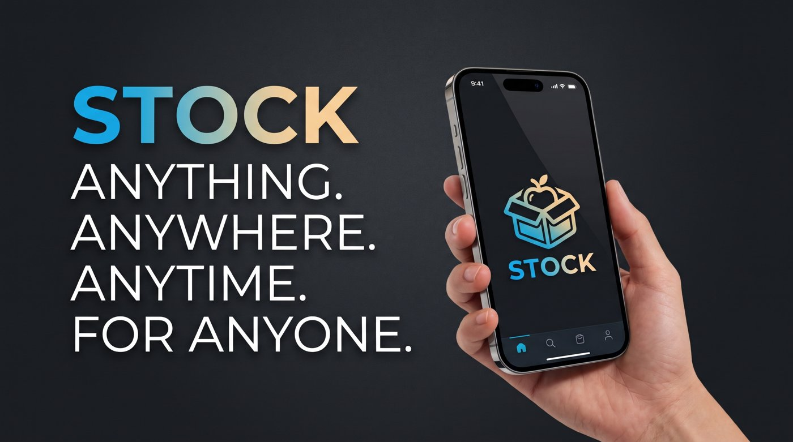
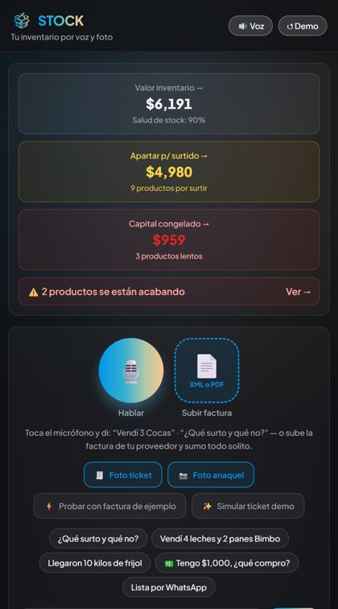
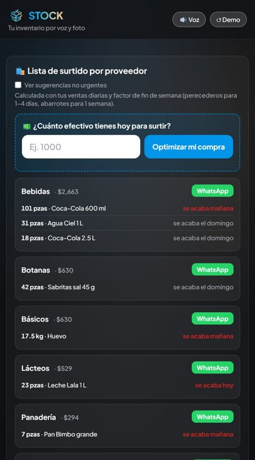
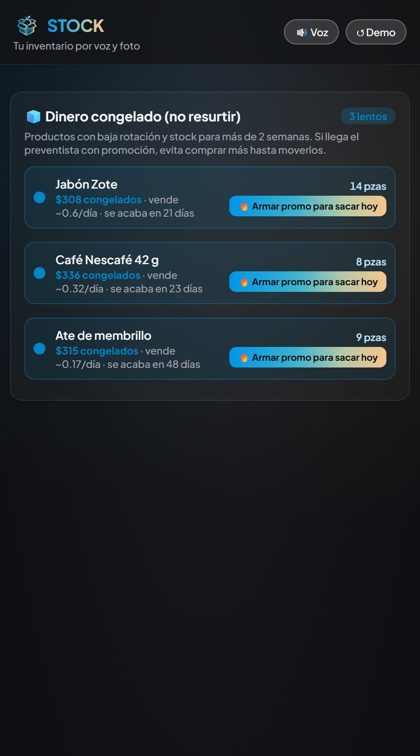
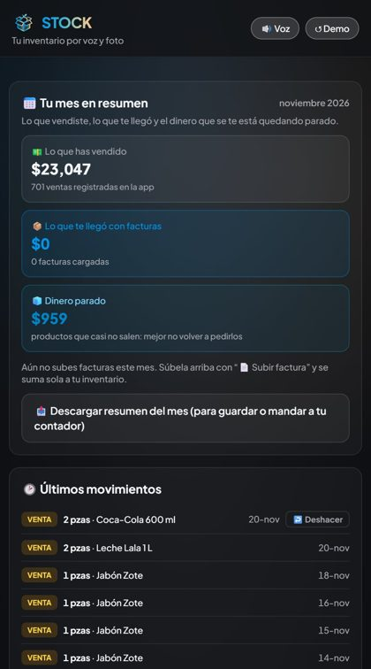
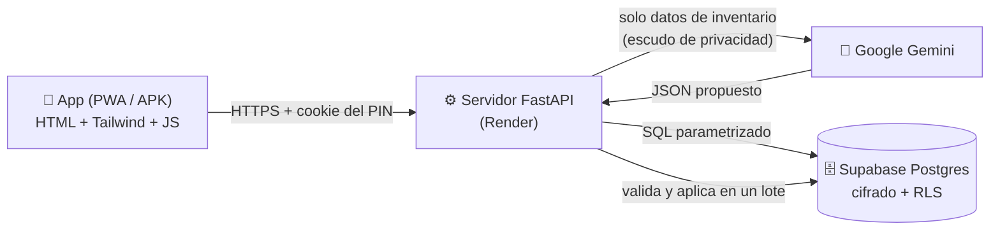

<p align="center">
  
</p>

<h1 align="center">STOCK</h1>
<p align="center"><strong>El asistente de inventario por voz para la tiendita de barrio.</strong><br>
Le hablas y STOCK lleva la cuenta: te dice qué se acaba, qué no volver a pedir y arma tu pedido por WhatsApp.</p>

<p align="center">
  <a href="https://stock-tienda.onrender.com/app"><b>▶ Abrir la app</b></a> ·
  <a href="https://github.com/Ernesto23lolxd/Prueba/releases/download/apk/STOCK.apk"><b>🤖 Descargar APK (Android)</b></a> ·
  <a href="https://stock-tienda.onrender.com">Portada</a> ·
  <a href="docs/DIAGNOSTICO_FINAL.md">🏁 Diagnóstico final</a>
</p>

<p align="center">Hackatón Tecno 2026 · Durango, México · Categoría: <i>Control de inventarios en pequeños negocios</i></p>

---

> **Para los jueces:** la tienda de la demo está protegida con PIN y pide aceptar el Aviso de Privacidad y los
> Términos. Pídanle el PIN al equipo. La primera carga puede tardar ~1 minuto (servidor gratuito que "despierta").

## 📉 El problema
- En Durango hay **61,400 micronegocios** (95.1 % de todos los negocios): dan el 41.9 % del empleo, pero solo el 20.5 % de los ingresos.
- **35.5 % de los negocios de Durango cerró entre 2019 y 2021**, más que el promedio nacional (32.6 %).
- Quiebran por **dinero atorado en mercancía, robo hormiga y merma, costos que suben y ventas perdidas**.
- Operan a ciegas: solo el **35.8 %** usa internet, el **1.3 %** de esos usa IA y el **84.5 %** cobra en efectivo.

<sub>Fuentes: INEGI (Censos Económicos 2024, Demografía de los Negocios 2021) y CANACOPE/CCE vía Posta Durango 2026. Detalle en <a href="docs/investigacion/IMPACTO_DURANGO.md">docs/investigacion</a>.</sub>

## 💡 La solución
| El tendero… | STOCK… |
|---|---|
| 🎙️ dice *"vendí 3 Cocas y 2 Sabritas"* | descuenta el inventario y contesta en voz alta |
| 📄 sube la factura (CFDI XML o PDF) de su proveedor | convierte cajas a piezas, empareja "CIEL 1000" con *Agua Ciel 1 L*, calcula el costo real y avisa si le subieron el precio 🚨 |
| 📸 toma foto al ticket o al anaquel | suma lo que llegó o cuenta lo que hay |
| 📥 sube su Excel tal como lo tiene | entiende sus columnas con IA |
| ⚠️ quiere saber qué se acaba | predice el día en que se termina cada producto |
| 🛍️ va a surtir | arma el pedido por proveedor y lo manda por WhatsApp |
| 💵 dice *"nomás tengo $1,000"* | reparte el dinero en lo más urgente sin pasarse ni un peso |
| 🧊 tiene mercancía que no sale | le dice qué no volver a pedir y le arma una promo |
| ↩️ se equivoca | deshace cualquier acción completa con un toque |

Funciona en **Android, iPhone y computadora**, se instala como app (o con el **APK**), abre aunque falle la señal y
trae **bienvenida y tutorial animado** de 17 pasos.

## 📱 Capturas
| Inicio | Surtir | Dinero parado | Mi mes |
|---|---|---|---|
|  |  |  |  |

## 🏗️ Arquitectura

**Regla de diseño:** la IA **propone**; Python **valida y calcula** (las cuentas de dinero nunca las hace la IA).

| Capa | Tecnología |
|---|---|
| App | HTML, Tailwind CSS, JavaScript; PWA (manifest + service worker); APK Android (Trusted Web Activity) |
| Servidor | Python 3.12, FastAPI, Uvicorn |
| IA | Google Gemini (voz, fotos, facturas, emparejamiento) |
| Datos | Supabase (PostgreSQL) en la nube · SQLite local |
| Infraestructura | Render (hosting), Cloudflare, GitHub Actions (compila el APK) |

## 🔒 Seguridad, privacidad y legalidad
- **PIN por tienda:** huella scrypt, sesión en cookie HttpOnly/SameSite/Secure firmada con HMAC, bloqueo tras 5 intentos.
- **Escudo de privacidad:** antes de usar la IA se quitan de la factura RFC, nombres, domicilios, correos, teléfonos, folio, sellos y certificados.
- Defensa contra inyección SQL, XSS, XXE, *prompt injection*, archivos disfrazados, abuso (límite por IP) y ventas simultáneas.
- Cabeceras de seguridad (CSP, HSTS, nosniff, DENY), base de datos cerrada al público (RLS), 0 secretos en el repositorio.
- **[Aviso de Privacidad](https://stock-tienda.onrender.com/privacidad)** (LFPDPPP) y **[Términos y Condiciones](https://stock-tienda.onrender.com/terminos)**, con aceptación obligatoria y constancia.

Detalle: [`docs/SEGURIDAD.md`](docs/SEGURIDAD.md).

## 💼 Modelo de negocio
| Plan | Precio | Incluye |
|---|---|---|
| **Barrio** | $0 · con anuncios locales | Inventario, semáforo, lista de surtido, 5 comandos de voz al día |
| **Tiendita** (principal) | **$149/mes** (menos de $5 al día) | Sin anuncios, voz y fotos sin límite, facturas, predicción, WhatsApp, escudo anti-inflación, 🎁 1 tarjeta NFC para reseñas en Google Maps |
| **Negocio Pro** | $299/mes | Todo lo anterior + funciones avanzadas, resumen para el contador, soporte prioritario, 🎁 2 tarjetas NFC |

- **Por tienda:** una Tiendita nos cuesta ≈ $33/mes y deja **+$116** (78 % de margen bruto).
- **Arranque:** inversión inicial ≈ $1,900, que se recupera en el mes 5; con 9 tiendas el piloto ya no pierde.
- **Meta realista del año 1:** **120 tiendas de paga** (2.4 % de la capital) → ≈ $24,480 de ingresos y ≈ $10,300 de utilidad al mes.

## ✅ Calidad: pruebas automatizadas
| Suite | Resultado |
|---|---|
| Funciones de punta a punta (voz real, facturas, Excel, deshacer…) | **32/32** |
| Facturas CFDI generadas y subidas (XML 4.0/3.3, PDF, USD, descuentos, servicios…) | **15/15** |
| Ciberseguridad (inyecciones, XXE, archivos trampa, PIN, sesiones falsas…) | **26/26** |
| Interfaz en 12 dispositivos (Android 320 px → monitor 2560 px) | **12/12** |
| App móvil (instalable, sin internet, iPhone) · Aviso legal y registro | **4/4 · 3/3** |
| Escudo de privacidad · Emparejamiento de productos | **2/2 · 35/35** |

19 fallas encontradas y corregidas durante las pruebas: [`docs/REPORTE_PRUEBAS.md`](docs/REPORTE_PRUEBAS.md).

## 🚀 Correrlo localmente
```bash
git clone https://github.com/Ernesto23lolxd/Prueba.git && cd Prueba/backend
pip install -r requirements.txt
echo "GEMINI_API_KEY=tu_clave" > .env          # sin DATABASE_URL usa SQLite local
python -m uvicorn main:app --port 8000          # abre http://localhost:8000/app
```
Pruebas: `python prueba_completa.py` (con el servidor encendido). Publicar en la nube: [`docs/DESPLIEGUE.md`](docs/DESPLIEGUE.md).

## 🗂️ Estructura
```
├── app/        Interfaz: app (index.html), portada, aviso de privacidad, términos, PWA e íconos
├── backend/    Servidor FastAPI: IA, inventario, facturas, PIN, privacidad, seguridad y pruebas (prueba_*.py)
├── android/    APK de Android (Trusted Web Activity)
├── demo/       Archivos de ejemplo: Excel, CSV, audios y factura
├── docs/       Documentación (ver tabla de abajo)
├── .github/    GitHub Actions: compila y publica el APK
└── render.yaml Despliegue en Render
```

## 📚 Documentación
| Documento | Contenido |
|---|---|
| [GUIA_DEL_CODIGO.md](docs/GUIA_DEL_CODIGO.md) | Cómo está armado todo, explicado por el equipo |
| [DIAGNOSTICO_FINAL.md](docs/DIAGNOSTICO_FINAL.md) | Auditoría final y veredicto |
| [REPORTE_PRUEBAS.md](docs/REPORTE_PRUEBAS.md) | Resultados de todas las pruebas y fallas corregidas |
| [SEGURIDAD.md](docs/SEGURIDAD.md) | Medidas de ciberseguridad, PIN y escudo de privacidad |
| [API.md](docs/API.md) | Rutas del servidor |
| [MOVIL.md](docs/MOVIL.md) | App instalable y APK de Android |
| [DESPLIEGUE.md](docs/DESPLIEGUE.md) | Publicar con Supabase + Render |
| [PITCH_SPEECH.md](docs/PITCH_SPEECH.md) | Speech del pitch y preguntas del jurado |
| [investigacion/](docs/investigacion/IMPACTO_DURANGO.md) | Datos de Durango y fuentes |

## 👥 Equipo
**Braulio** (backend e IA) · **Jorge** · **Ernesto** (diseño de la app y pitch) · **Sebas** (diseño e identidad visual)

<sub>Proyecto desarrollado para el Hackatón Tecno 2026 · Durango, México.</sub>
